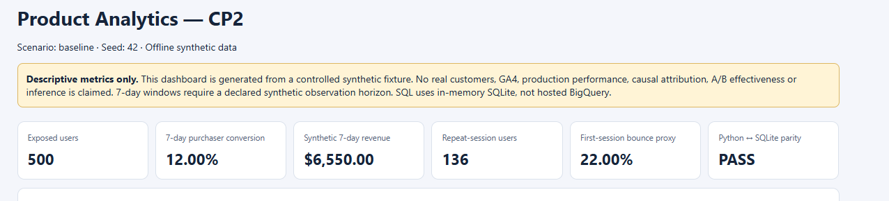
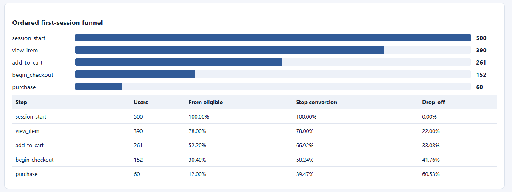
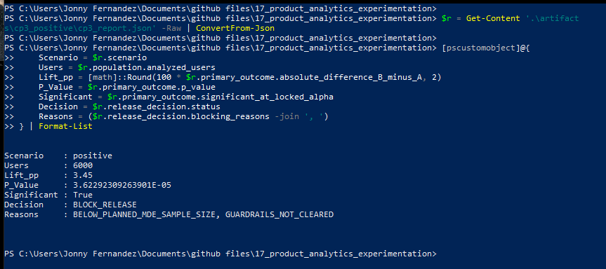

# Project 17 — Product Analytics, Experimentation & Causal Measurement Platform

A **fully offline, reproducible portfolio project** for event-level product analytics and disciplined A/B experiment evaluation. It uses **deterministic synthetic user/event data**, Python, local SQLite, and a self-contained HTML dashboard. It does **not** use real customers, hosted GA4, production BigQuery, paid models, or production traffic.

## Additive upgrade — consent-aware event instrumentation (October 2026)

An **independent local synthetic instrumentation demo** now sits beside the original locked offline experiment. It adds a consent-aware JavaScript mock storefront, loopback-only HTTP endpoints, a versioned [tracking plan](configs/tracking_plan_v1.json), SQLite event storage, strict client/server source separation, deduplication/quarantine, monitor alerts, and a deterministic historical replay feeding the **unchanged** Python and SQL metrics. See the [CP2 instrumentation upgrade runbook](docs/CP2_INSTRUMENTATION_UPGRADE.md). The new local app **does not** connect to GA4, Segment, PostHog, or real customer traffic.

The independently preserved pre-upgrade baseline is **110/110 passing Windows tests**, captured at commit `21e13ff`. CP2 expanded this to **135/135 Windows tests**; CP3 added three on-disk checksum/replay integrity tests and the user verified **138/138 Windows tests** on October 20, 2026 (156.27 seconds). These are local results, **not yet upgraded GitHub Actions results**. Prior 107-test evidence is a historical checkpoint, not the current suite.

Local-only usage after installing `requirements-ci.txt` and the editable package:

```bash
python -m product_analytics.instrumentation.demo --db artifacts/cp2_upgrade_demo/events.sqlite --out-dir artifacts/cp2_upgrade_demo
python -m product_analytics.instrumentation.webapp --port 8765 --db artifacts/cp2_upgrade_web/events.sqlite
# Windows CP3 evidence collector (runs complete pytest, digest/replay/audit checks)
# .\.venv\Scripts\python.exe scripts\project17_cp3_quality_evidence.py
```

Open `http://127.0.0.1:8765`; the mock storefront sends events **only after demo consent**. New real-time demo events remain blocked from seven-day metrics until their observation windows mature. The historical replay (separate local DB) verifies the original Python/SQLite metric parity on synthetic historic events.

The [instrumentation QA runbook](docs/CP3_INSTRUMENTATION_QA.md) describes the corrected on-disk JSON/SHA-256 handling. On the user's Windows machine, CP3 confirmed two byte-identical **24-user / 132-event** seeded runs, valid report hashes, Python/SQLite parity, and a local source audit with zero findings. In a **separate browser demonstration**, the monitor reported **23 accepted events**, zero schema errors/quarantined attempts, and `release=BLOCK`, reason `INCOMPLETE_7_DAY_WINDOW`. The monitor screenshot does **not** independently prove a specific purchase record was persisted.

The [CP4 upgrade release checklist](docs/CP4_UPGRADE_RELEASE.md) and [8-image evidence folder](screenshots/) distinguish genuine user screenshots from clearly labeled source-based or dashboard renderings; they do not certify a deployed system.

## What the system demonstrates

| Area | Implemented scope |
| --- | --- |
| Event quality | Typed UTC event contracts; eligible exposure and assignment timing; synthetic session/purchase journeys; invalid/duplicate/assignment-conflict negative cases. |
| Product measurement | 7-day purchase conversion, revenue, ordered first-session funnels and drop-off, D1/D3/D7 retention, cohorts, device/channel segments, repeat sessions, and journeys. |
| Attribution | First-touch, last-touch, and linear multi-touch **descriptive** credit comparisons; no causal attribution claims. |
| SQL reconciliation | Independent in-memory SQLite calculations cross-checked against Python at the user/metric level (25-field parity in verified CP2 fixtures). |
| Reporting | Reproducible CSV/JSON artifacts and a self-contained HTML dashboard. |
| Experimentation | Locked local experiment design, randomization/SRM checks, predeclared conversion outcome and guardrails, effect estimates, confidence intervals, power/MDE/sample planning, multiplicity controls, separate synthetic CUPED illustration. |
| Safety and reproducibility | Fail-closed release gate; tampered-evidence and credential-pattern checks; staged-Git-index audit; Python/pytest regression suite; Windows and Ubuntu GitHub Actions workflow. |

### Offline product dashboard





More **genuine user-captured screenshots**, with exactly named files, are in [docs/screenshots](docs/screenshots/) and [the evidence guide](docs/SCREENSHOT_PLAN.md).

## Verified local evidence (October 2026)

- **Pre-upgrade baseline:** 110/110 Windows tests passed at `21e13ff`; this supersedes the older 107-test screenshot/checkpoint described in `docs/SCREENSHOT_PLAN.md`.
- **CP2 local instrumentation:** 135/135 Windows tests passed in 150.75 seconds; the synthetic 24-user replay recorded 132 events and passed Python/SQLite parity.
- **CP3 full regression/integrity:** **138/138 Windows tests passed in 156.27 seconds**; two independent 132-event seeded replays generated byte-identical reports and matched saved-file SHA-256 digests.
- **CP3 source audit:** zero findings in the source tree audited for the CP3 evidence bundle. This was **before** staging the final new documentation/screenshots, so a fresh Git-index scan is required.
- **Manual consent flow:** declining consent produced “Consent is required. Nothing was recorded.” The browser quality monitor for a separate synthetic session showed 23 accepted events, 0 schema errors, 0 quarantined attempts, and `release=BLOCK` due to an incomplete seven-day window.
- **Screenshot evidence:** see [`screenshots/README_SCREENSHOTS.txt`](screenshots/README_SCREENSHOTS.txt) for 8 filenames and the provenance of each image. Source/log renderings are labeled and must not be described as genuine Windows console captures.
- **CI status:** the original baseline's Windows/Ubuntu GitHub Actions run passed before the upgrade. **Do not claim the upgraded CI passes until both hosted jobs succeed on the exact published commit.**

### A/B evaluation: a significant result can still be blocked

Synthetic positive scenario (6,000 assigned users, seed 1703): observed conversion difference **+3.45 percentage points** (95% CI approximately **+1.82 to +5.08 pp**, two-sided p approximately **0.000036**). The locked decision is **`BLOCK_RELEASE`**, not an approval: sample size is below the prespecified 5% relative-MDE plan, and strict guardrails have not been cleared. A broken-allocation SRM scenario and an underpowered scenario also correctly block release. This is an illustrative controlled synthetic fixture, **not an observed real-world causal effect**.



See [CP3 implementation](docs/CP3_IMPLEMENTATION.md), [experiment design](docs/EXPERIMENT_DESIGN.md), and [locked design](configs/cp3_preregistered_design.json).

## Reproduce locally

**Requirements:** Python 3.11+; no cloud account or API keys. The commands below run with an isolated environment.

```bash
python -m venv .venv
# Windows PowerShell: .\.venv\Scripts\python.exe
# macOS/Linux:       .venv/bin/python
python -m pip install -r requirements-ci.txt
python -m pip install -e . --no-deps
python -m pytest -o addopts='' -q
```

On Windows, activate the virtual environment first or replace `python` with `& .\.venv\Scripts\python.exe` in each command. On macOS/Linux, use `source .venv/bin/activate`.

Generate the reproducible dashboard and statistical scenarios:

```bash
python -m product_analytics.data.cp2_report --scenario baseline --users 500 --seed 42 --out-dir artifacts/cp2_baseline
python -m product_analytics.data.cp3_report --scenario positive --users 6000 --seed 1703 --out-dir artifacts/cp3_positive
python -m product_analytics.data.cp3_report --scenario null --users 6000 --seed 1704 --out-dir artifacts/cp3_null
python -m product_analytics.data.cp3_report --scenario srm --users 1200 --seed 1705 --out-dir artifacts/cp3_srm
python -m product_analytics.data.cp3_report --scenario underpowered --users 60 --seed 1706 --out-dir artifacts/cp3_underpowered
python -m product_analytics.audit.cp4_audit --evidence-root artifacts --out artifacts/cp4/cp4_audit_report.json
```

Open `artifacts/cp2_baseline/cp2_dashboard.html` locally. Synthetic CSVs and reports are excluded from Git; generate them instead. The optional Git-index audit uses `--git-index` on a **locally initialized and staged** repository, and does not imply a complete secret-scan or Git-history review.

## Project map

- [Project plan](PROJECT_PLAN.md) and [consolidated checkpoints](CHECKPOINTS.md)
- [Event contract](docs/GA4_EVENT_SCHEMA.md) · [KPI metric tree](docs/METRIC_TREE.md)
- [CP1 validation](docs/CP1_IMPLEMENTATION.md) · [CP2 product analytics](docs/CP2_IMPLEMENTATION.md) · [CP3 experimentation](docs/CP3_IMPLEMENTATION.md)
- [CP4 audit design and limitations](docs/CP4_PREPUBLICATION.md) · [Local verification evidence](docs/PROJECT17_VALIDATION_EVIDENCE.md)
- [SQLite queries](sql/local_product_metrics.sql) · [Tests](tests/) · [GitHub Actions workflow](.github/workflows/offline-ci.yml)
- [Original screenshot evidence plan](docs/SCREENSHOT_PLAN.md) · [Upgrade evidence provenance and files](screenshots/README_SCREENSHOTS.txt) · [CP4 upgrade release checklist](docs/CP4_UPGRADE_RELEASE.md)

## Limitations and interpretation

1. All event and experiment results are **synthetic and locally authored**, not independent blind holdouts; local design-lock hashing is not independent preregistration.
2. BigQuery-related starter files are **not evidence of hosted BigQuery runs**; SQL parity was checked via local SQLite. No Power BI service/dashboard was deployed.
3. Descriptive marketing attribution does not establish causality. The CUPED comparison is a separate synthetic demonstration, not the estimator for the displayed binary conversion uplift.
4. No real customer data, traffic, production deployment, system availability, live experiment rollout, real-world fairness, or business impact is claimed.
5. The local Git pattern scanner is not a substitute for professional secret scanning, independent attestation, or a full repository history review. A local Windows PASS is not a cloud CI PASS; the exact post-publication commit must be verified.

## License

MIT — see [LICENSE](LICENSE).
